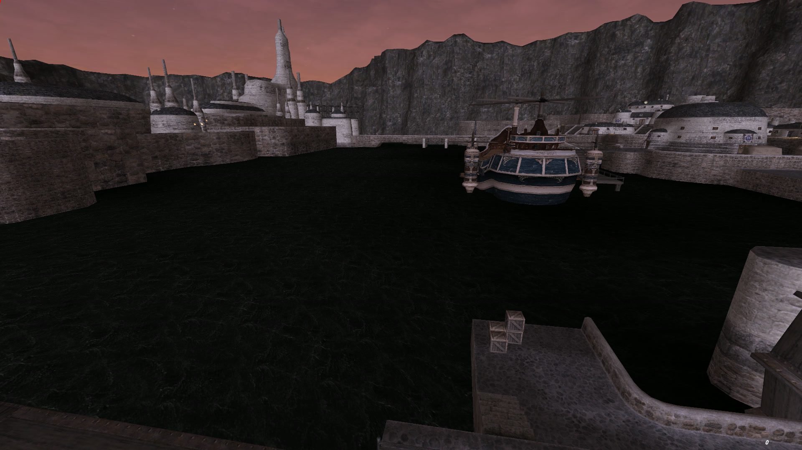
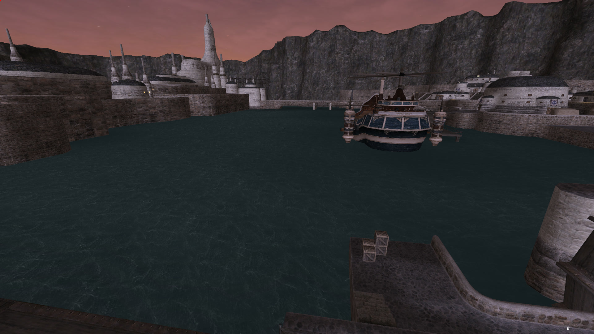
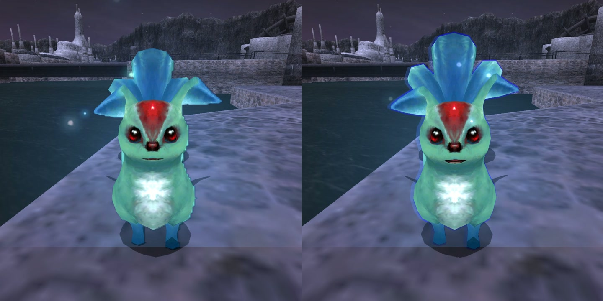
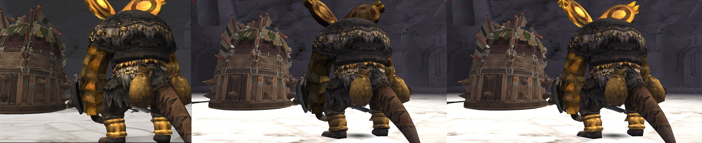

https://github.com/user-attachments/assets/a4cede68-3c31-4334-9e31-f83d5efd8a8f
# portfix

Fixes for graphics that the PC version of FINAL FANTASY XI draws incorrectly. The affected effects were written for the PS2 renderer and were not adapted to PC depth buffers and resolutions.

Initially created to fix the Port Bastok water, it has evolved into fixing other effects as well.

All fixes are on by default. The water, halo and shine fixes only change the order, texture, position, batching or blend stages of draws the game already makes. The disintegrate fix restores a PS2 effect the PC skips: it patches two places in the game's code and draws the effect's pieces itself.

Builds: Ashita v4 plugin, Windower 4 addon.

Installation: [docs/INSTALL.md](docs/INSTALL.md).
Technical details: [docs/TECHNICAL.md](docs/TECHNICAL.md).

## Fixes

### Black water

Layered water, for example in Port Bastok and Bastok Markets, renders black near the camera. The fix restores the intended colour.

| Off | On |
|---|---|
|  |  |

### Summon halos

Summons such as Carbuncle are drawn with a stair-stepped outline. The PS2 version draws a soft outline halo. The fix restores the halo.
| Before and After |
|---|
|  |

| Comparison Video |
|---|
| https://github.com/user-attachments/assets/ef2ff32c-264b-4fc0-bbfc-3d6319ae7ff3 |
| PS2 at 3x resolution, PC with no fix, PC with portfix |

### Sphere-map shine

Metal parts of some models, such as Warlord Rojgnoj's gold armour, reflect a sphere map. On the PC the reflection reads the wrong part of the map at half the PS2 strength, so the metal looks dull. The fix restores the PS2 shine.

| Comparison |
|---|
|  |
| PS2 at 3x resolution, PC with no fix, PC with portfix |

### Weapon shine

Shiny weapons such as the Claymore gleam on the PS2 as they catch the light. On the PC they stay flat grey: the highlight is aimed away from the light at half strength, and in many weapon models the PC files lost the boundary between the plain and shiny parts, so the shiny part is drawn as plain. The fix aims the highlight at the light with the PS2's spread and colour, and draws each part with its own material again.

| Comparison |
|---|
| https://github.com/user-attachments/assets/b21fc8d0-696a-4abd-a1d5-a881a23c1e8c |
| PS2 at 3x resolution, PC with no fix, PC with portfix. |

### Disintegrate

Some effects break a model up, most notably the Shadow Lord's change of form in the Throne Room. On the PS2 the first form comes apart into dark shards with purple smoke. On the PC it stays whole. The fix restores the break-up, smoke and haze.

| Shadow Lord Comparison |
|---|
| https://github.com/user-attachments/assets/e4dc0fc8-a7fa-40bc-849b-1b7e05213d57 |
| PS2 at 3x resolution, PC with no fix, PC with portfix |

## Commands

Ashita: `/portfix`. Windower: `//portfix` in chat, `portfix` in the console.

| Command | Action |
|---|---|
| `/portfix` | List fixes and their state. |
| `/portfix water [on\|off]` | Black water fix. No argument toggles. |
| `/portfix halo [on\|off]` | Summon halo fix. No argument toggles. |
| `/portfix shine [on\|off]` | Sphere-map and weapon shine fixes. No argument toggles. |
| `/portfix disint [on\|off]` | Disintegrate effect fix. No argument toggles. |
| `/portfix help` | List commands. |

Settings are not saved. All fixes are on each time the plugin loads.

## Updates

On load, portfix asks GitHub for the latest release. If it is newer than the one installed, a line in chat says so once you are in game. Nothing else is sent, and nothing is downloaded.

## Licence

MIT.
