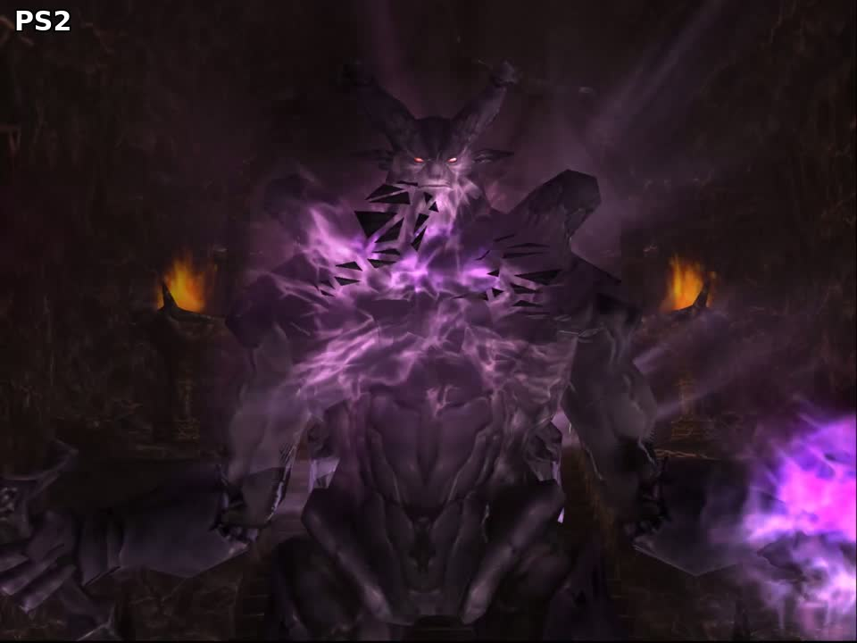
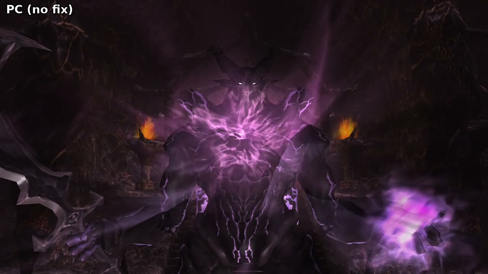
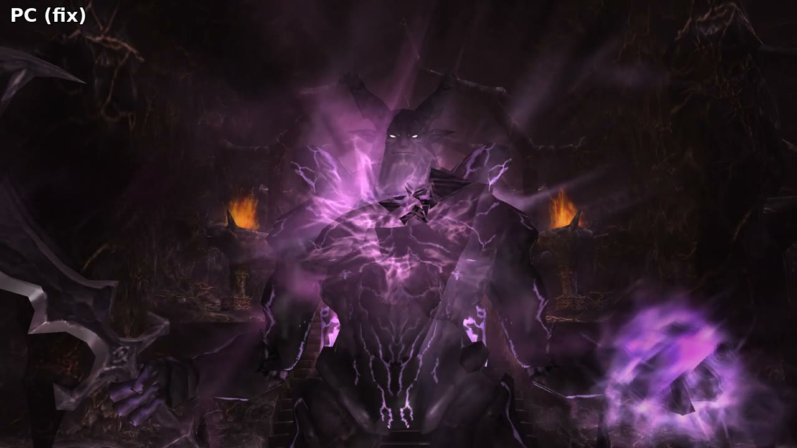

# Technical details

portfix intercepts Direct3D 8 draw calls made by FFXiMain.dll. The fix logic is in `core/fixes.cpp` and `core/disint.cpp`. Each launcher build forwards four device calls to it: DrawPrimitive, DrawIndexedPrimitive, DrawPrimitiveUP and Present. A fix either passes a draw through, holds it, or replaces it with an edited copy. The disintegrate fix also patches two places in FFXiMain.dll's code and makes draws of its own. Draws issued by portfix are marked so they are not processed a second time.

## Launcher builds

### Ashita v4

`ashita/src/portfix.cpp` is an Ashita plugin. It receives the device calls through the plugin Direct3D callbacks. Returning true from a callback skips the game's draw. The plugin priority is -10, so it runs before other plugins.

### Windower 4

Windower has no public plugin interface. `windower/portfix/portfix.lua` is a Lua addon. It loads `portfix.dll` with `package.loadlib` and calls `luaopen_portfix`. The dll takes the Lua functions it uses from `LuaCore.dll` at run time.

The dll hooks the device by patching four slots of its vtable: Present (15), DrawPrimitive (70), DrawIndexedPrimitive (71) and DrawPrimitiveUP (72). The device is the one the game uses. FFXiMain.dll keeps its renderer object in a global and the device at renderer + 8. The global is found by this byte pattern in FFXiMain.dll, at the code that creates the renderer:

```
68 78 04 00 00      push 478h
C6 44 24 0B 00      mov byte ptr [esp+0Bh], 0
E8 ?? ?? ?? ??      call operator new
83 C4 04            add esp, 4
85 C0               test eax, eax
0F 84 ?? ?? ?? ??   jz
8B C8               mov ecx, eax
E8 ?? ?? ?? ??      call constructor
85 C0               test eax, eax
A3 <global>         mov [global], eax
```

Under Windower the device is Windower's wrapper object. The patch applies to all objects of the wrapper class. Calls on other objects of that class pass through.

The dll does not create a Direct3D object or device. Launchers hook Direct3DCreate8 and treat a new device as the game's device. Under Ashita this reset Ashita's managers and stopped its command handling.

The patch is not removed. The dll pins itself so it stays loaded after the addon unloads. On unload the addon turns all fixes off. Fix state changes from Lua are applied on the render thread at the next Present.

The dll also exports `portfix_start` and `portfix_set(water, halo, disint, shine)` for loading it without Lua.

### Release check

`core/update.cpp` runs once on load, on its own thread: a WinHTTP GET of `https://api.github.com/repos/voetre/portfix/releases/latest` with a 5 second timeout. The `tag_name` (without its leading `v`) is compared number by number with `PORTFIX_VERSION` in `core/update.h`. If it is newer, the message waits until the player is in game: Ashita checks at each Present, and the Windower addon calls `update()` every 5 seconds. Any failure (no network, rate limit, unexpected reply) ends the check without a message. The thread holds a reference on the dll while it runs.

## Saving and restoring device state

Two fixes draw with their own settings and must leave the game's state as it was: the water fix's held ripple layer, and Disintegrate's pieces and haze. Both used to save the whole device in a Direct3D 8 state block (`CreateStateBlock(D3DSBT_ALL)` / `ApplyStateBlock`). They now save and restore by hand only the settings portfix's draws use (`Fixes::DrawState`):

- 40 render states, stages 0 and 1, the world, view, projection and texture transforms, textures 0 to 3, vertex stream 0, and the vertex and pixel shaders.
- References to the textures and the vertex buffer are let go at the end of each frame.

Reason: wrappers that implement Direct3D 8 themselves may not capture and apply a whole block the same way. With dgVoodoo, Port Bastok's sea came out a flat opaque sheet (GitHub issue #1), which fits the ripple layer being drawn without its blend settings. This is untested with dgVoodoo: current dgVoodoo crashes under Wine and Proton while creating the device (Wine bug 58731), so it can't be run in the test harness.

## Debug log

`/portfix debug on` (off by default, not saved) writes:

- On Ashita, to Ashita's session log; on Windower, to `portfix.log` next to the dll.
- When turned on: the version, which fixes are on, the Direct3D DLLs loaded (path plus the file's own description and version, so DXVK or dgVoodoo show by name), the adapter, the device flags, the back and depth buffers and the capabilities the fixes check.
- Then one line per rare event: a fix that can't start, a weapon model's draws rebuilt by the shine split, the highlight cube built, and the first draw each fix takes over. Nothing per frame, and at most 2000 lines a session (`core/debuglog.h`).

## Black water

### Symptom

Layered water renders black near the camera. Distant water renders correctly. Seen in Port Bastok and Bastok Markets. There are two causes. The one below is Port Bastok's. Bastok Markets' canals have a second one, described after the fix.

### Draw sequence

Each water surface is three flat planes drawn in this order. World heights are from Bastok Markets.

| # | Layer | Height | Draw | State |
|---|---|---|---|---|
| 1 | Depth darkening | 63.773 | DrawPrimitive | Untextured. TEXTUREFACTOR 96000000. Stage 0 colour MODULATE2X(CURRENT, TFACTOR), alpha MODULATE4X. Output is opaque black. Z-write on. |
| 2 | Ripples | 63.819 | DrawPrimitive | FVF XYZ, NORMAL, DIFFUSE, TEX1. Lighting off. Blend SRCALPHA, ONE. Stage 0 MODULATE(TEXTURE, TFACTOR). Texture transform COUNT2 (scrolling). Z-write on. |
| 3 | Tint | 63.796 | DrawPrimitive | Same vertex buffer as layer 1. TEXTUREFACTOR about 9619283x, changes each frame. ZFUNC LESSEQUAL. |

Layer 3 lies about 0.023 units below layer 2.

### Cause

Depth precision. At a distance of about 37 units the depth difference between layers 2 and 3 is about 7.8e-7 in z/w. A 24-bit depth buffer has steps of about 6e-8, so the difference is about 13 steps. Layer 3 fails the LESSEQUAL test against the depth written by layer 2. Only the black of layer 1 and faint ripples remain. A 16-bit depth buffer has steps of about 1.5e-5. At that precision layers 2 and 3 fall on the same depth value and layer 3 passes. Far from the camera the difference falls below one 24-bit step and the water renders correctly.

The layering was made for the PS2 renderer and was carried over to the PC version unchanged. No ZBIAS is used. Fog is not involved.

Forcing a 16-bit depth buffer was tested. It restores the tint at a distance, with banding, but not near the camera. Depth precision is the mechanism, but 16-bit depth alone does not reproduce the PS2 output. The PS2 renderer differs in at least one other respect: depth format, near plane or draw order. This is not known.

### Fix

1. Detect layer 2 by its state: FVF XYZ, NORMAL, DIFFUSE, TEX1, Z-write on, alpha blend on, SRCBLEND SRCALPHA, DESTBLEND ONE, lighting off, stage 0 texture transform COUNT2, stage 0 colour op MODULATE.
2. Record the full device state in a D3DSBT_ALL state block. Skip the draw.
3. Draw the next DrawPrimitive (layer 3) unchanged.
4. Save the current state, apply the recorded state, disable Z-write, draw layer 2, restore the saved state.

The resulting order is 1, 3, 2. A held draw is also released before the next DrawIndexedPrimitive or DrawPrimitiveUP. A held draw still pending at Present is dropped.

An earlier version drew layer 2 in place with Z-write off. Layer 3 then covered it fully, because its alpha saturates under MODULATE4X. The water showed flat tint with no ripples.

### Second cause: the water pass's near plane (Bastok Markets)

Reported after v1.2: Bastok Markets' canals still went black with the camera close, for example on the stairs down to Bastok Mines. The fix above did not apply there. The canal's ripple layer has Z-write off, so it does not match the detection, and the canal fails for a different reason.

The canal has an opaque plane of its own: dark, lit tiles (FVF XYZ, NORMAL, DIFFUSE, TEX1, lighting on, no blend, Z-write on) drawn with the rest of the scene. The scrolling water layers lie 0.0415 below it. The game draws the scene with a projection near plane of 0.1 and the water pass with a near plane of 0.1003 (projection `_43` -0.1000 against -0.1003), and both passes share one depth buffer. With z/w = 1 - n/d, the larger near plane puts every water fragment at the depth of a point 0.3% closer. Along a view ray the 0.0415 gap is 0.0415 × distance / camera height. The water passes LESSEQUAL only while that is less than 0.3% of the distance, so only with the camera more than 0.0415 / 0.003 ≈ 14 yalms above the water. The gap and the bias both grow with distance, so the result does not depend on distance: below about 14 yalms the whole canal turns black at once.

Measured on the Markets stairs: black with the camera 11.1 yalms above the water, correct at 14.7. 16-bit depth also restores the colour at 11.1, because it rounds the two depths to the same value.

### Fix, second part

Every scrolling water layer is drawn 0.05 yalms higher: FVF XYZ, NORMAL, DIFFUSE, TEX1, lighting off, alpha blend on, stage 0 texture transform COUNT2. The held ripple layer from the first part counts as one of these. The water's world matrix includes the view, so the lift is taken along the matrix's second row (world down; FFXI's y points down). Lifted 0.05, the layers sit above the opaque plane, so they pass at any camera height and distance. 0.05 yalms is less than a pixel at play distances. The opaque plane and everything else are drawn as they are.

Checked in the harness:
- Bastok Markets, eight camera positions down the stairs: the canal is blue-teal with the fix and grey-black without, at every height below about 14 yalms. Above it, nothing changes.
- Port Bastok's sea: the same colour as v1.2 (mean RGB 54,63,71 against 54,63,72; 41,43,44 with the fix off).
- Windurst Waters, Port Windurst, Southern San d'Oria, Bastok Mines: no visible change in views without water.

Not a bug: from low down by the Mines stairs, the canal right in front of the camera stays dark grey with the fix on or off, and with any lift up to 1.0. Projecting every water layer's vertices onto that frame shows why: the zone's water mesh has a hole there, so only the canal's opaque plane is drawn, and the ripple layer's vertex alpha fades to 0 toward the hole's edge, which gives the soft teal-to-dark boundary. No other draw covers the hole. This is authored data, and a PS2 frame from low down shows the same near-black water.

### Faithfulness

The fix is an approximation. The PS2 method of combining these layers is not known. The result was compared by eye with reference screenshots.

### Measured colour

Port Bastok, mean RGB of water regions.

| Mode | Far | Mid | Near |
|---|---|---|---|
| Fix off | 8,8,8 | 11,11,11 | 11,11,11 |
| 16-bit depth, fix off | 16,23,28 | 14,17,19 | 11,12,12 |
| Fix on | 25,35,42 | 28,38,45 | 28,38,45 |

## Summon halos

### Symptom

On the PS2, summons such as Carbuncle have a blue-violet halo around the silhouette, about 3 to 5 PS2 pixels wide, made of several offset copies of the outline. On the PC the same layer is a thin rim, stair-stepped in blocks of 4 to 6 pixels.

This halo is separate from the ground disc and sparkle effect (scheduler `efon`). That effect is started by the server and renders correctly on the PC.

### Draw sequence

1. Each mesh part is drawn lit, then drawn into a 4096x4096 silhouette texture.
2. One DrawPrimitiveUP quad copies the silhouette into a 256x256 render target. FVF XYZRHW, DIFFUSE, TEX1. Stride 28. Triangle strip, 2 primitives.
3. The 256x256 copy is drawn over the scene as full-screen quads:
   - Three ghost copies. Colour MODULATE2X, alpha MODULATE4X, blend SRCALPHA, INVSRCALPHA. Diffuse 1E0000FF, 0F6262FF, 140000FF. Each is offset by about 3.1 pixels in a pattern that rotates each frame. Example offsets: (1.17, 2.90), (4.06, -1.63), (-1.16, -2.90).
   - One opaque, alpha-tested copy at offset 0. Colour op SELECTARG2.
4. The full-size silhouette is drawn on top. Diffuse 80808080.

### Cause

Two values were carried over from the PS2 unchanged.

1. Copy resolution. At PC render sizes one texel of the 256x256 copy covers about 16 pixels. The opaque copy extends past the model edge as stair steps. Skipping the opaque copy removes the rim. Skipping the final silhouette shows the blocky copy alone.
2. Offset size. The offsets of about 3 pixels are in PS2 frame pixels. At 4096 pixels wide the ghost copies do not separate from the model.

### Fix

1. Detect the copy in step 2 by render target size 256x256. Record the source texture (the silhouette) and the 256x256 surface.
2. Detect the quads in step 3: DrawPrimitiveUP, stride 28, FVF XYZRHW, DIFFUSE, TEX1, triangle strip, 2 primitives, stage 0 texture whose level 0 surface is the recorded 256x256 surface.
3. Draw each of these quads with the full-size silhouette bound in place of the copy. Multiply the quad offset by render width / 640: each vertex moves by (x0, y0) * (k - 1), where (x0, y0) is the first vertex and k = width / 640.

Colours, blend states, ghost count and the offset pattern are the game's own.

### Faithfulness

This is a correction of two parameters in the game's own effect, not a reimplementation. Known differences from the PS2:

- The factor 640 assumes the offsets are in units of a 640-pixel-wide frame. The PS2 frame size for this effect was not verified.
- On the PS2 one texel of the 256x256 copy covers about 2.5 screen pixels. The low resolution softens the halo. With the full-size silhouette the halo edge is sharper than on the PS2. A closer match would keep a low-resolution copy at the same texel-to-pixel ratio, about 768x768 at 1920 pixels wide.
- The PS2 GS sampling and blending are not emulated.
- The result was compared by eye with PS2 recordings. It was not measured.

## Sphere-map shine

### Symptom

Some model parts reflect an environment texture (the model's `evev` texture, for example Warlord Rojgnoj's gold plates in Qu'Bia Arena cutscene 32004). On the PS2 the gold is bright, with a light centre on faces turned to the camera. On the PC it is dull and dark.

### Mechanism on the PS2

The model is drawn, then drawn again with the environment texture. The second pass blends Cs x Ad + Cd: the texture colour times the destination alpha, added to the frame. The colour is 0x80 x strength / 255, where strength is a per-batch byte in the model's material table. The destination alpha is the alpha the first pass wrote, the model texture's alpha, on the GS scale where 0x80 is 1.0 and 0xFF is about 2.0. The texture coordinates are u = 0.5 + 0.5 nx, v = 0.5 - 0.5 ny, from the camera-space normal.

The mapping and the scale were measured in PCSX2 by replacing the environment texture in EE RAM with a coordinate gradient and by setting the strength bytes to 255.

### Draw on the PC

One draw does both passes:

- Stage 0: model texture x diffuse x 2. Alpha: texture alpha x TEXTUREFACTOR alpha x 2, where TEXTUREFACTOR alpha is strength / 2.
- Stage 1: MODULATEALPHA_ADDCOLOR (current + current alpha x environment texture). Texture coordinates CAMERASPACENORMAL, COUNT3, through an identity texture matrix (with _33 = 0, _43 = -1), clamped.

### Cause

- The texture matrix maps the normal straight to (u, v) = (nx, ny). Only one quarter of the sphere map is used, and a face turned to the camera reads the map's dark corner instead of its centre.
- Stage 0 alpha is texture alpha x strength on the 0xFF = 1.0 scale. The PS2 uses the 0x80 = 1.0 scale for the destination alpha, so the PC adds half the reflection.

The strengths and the environment texture are the same as on the PS2.

### Fix

1. Detect the draw: DrawIndexedPrimitive with stage 1 COLOROP MODULATEALPHA_ADDCOLOR, arguments CURRENT and TEXTURE, and TEXCOORDINDEX CAMERASPACENORMAL | 1.
2. Set the stage 1 texture matrix to u = 0.5 nx + 0.5, v = -0.5 ny + 0.5.
3. Stage 1: TEXTURE MODULATE2X (CURRENT | ALPHAREPLICATE) into TEMP. The stage alpha is the game's own. Stage 2: CURRENT + TEMP, alpha from TEMP. Stage 3 off.
4. Draw, then restore the states and the matrix.

The fix needs D3DPMISCCAPS_TSSARGTEMP and three blend stages. Without them the game's draw is left alone.

### Faithfulness

- The PS2 adds the reflection after the first pass is blended and fogged. The PC adds it inside the same draw, so fog applies to both.
- The PS2 destination alpha is taken after the alpha test. The PC uses the stage 0 alpha directly. These are the same for opaque parts.
- The GS clamps each pass to 0xFF. The PC clamps the reflection term and the sum separately, with the same result for values in range.
- Compared by eye with PS2 screenshots of the same cutscene frame.

## Reflection-vector shine

### Symptom

Shiny weapons and armour (a Claymore on the back in the Mog House, from a user's report) gleam on the PS2: from below, the blade turns bright gold-white. On the PC they stay flat grey from any angle.

### Mechanism on the PS2

Batches whose material byte +7 is set get a second pass after the base pass (FUN_002b6940): Cs x Ad + Cd, with one 64x64 highlight texture shared by every such batch (a white spot fading out from the centre). The vertex colour is the light's colour x strength / 256 (0x80 = 1.0): 92 70 38 for strength 100 under a lamp of 1.85 1.40 0.76. The destination alpha is the base pass's texture alpha (0x80 = 1.0).

The texture coordinates are the sphere-map position of the world reflection vector in a frame fixed to the light: brightest when the eye's reflection points at the light, and fading out over about 45 degrees (radius 0.6 x sin(angle / 2), 0.5 being the texture's edge).

Measured from PCSX2 GS dumps of the same Mog House frame at three camera positions: the pass's texture decoded from the dump, its ST/Q paired with the PC's vertices (by base UV, position and normal), and candidate mappings fitted. Moving the camera sideways without turning it changes ST, so it follows the reflection, not the normal; one world-fixed frame fits all three positions (camera-fixed fits worse).

### Draw on the PC

Mode 1 of the skinned-part draw (material float +0x28 set):

- Stage 1: MODULATEALPHA_ADDCOLOR of a global cube ("cubemap spec"), texture coordinates CAMERASPACEREFLECTIONVECTOR, COUNT3, through diag(1, -1, -1) x camera-to-world x the light's view (a LookAt from light 0).
- The cube's -Z face (towards the light) is the PS2's spot texture, pixel for pixel; the other faces are black.
- Stage 0 alpha: texture alpha x TEXTUREFACTOR alpha x 2, TEXTUREFACTOR alpha = strength / 2.

### Cause

- The diag(1, -1, -1) turns the reflection over. The spot is found when the reflection points away from the light: under a ceiling lamp, at the floor. Without it, the spot's world direction is the light's.
- Pasting the sphere-map texture onto a cube face halves its spread: a face's radius goes with tan(angle), the PS2's with 0.6 x sin(angle / 2).
- The highlight is white and at half strength: the light's colour isn't in it, and the stage-0 alpha is the PS2 alpha read on the 0xFF = 1.0 scale (as for the sphere-map shine).

### Fix

1. Detect the draw: DrawIndexedPrimitive with stage 1 MODULATEALPHA_ADDCOLOR (CURRENT, TEXTURE), TEXCOORDINDEX CAMERASPACEREFLECTIONVECTOR | 1, and a cube on stage 1.
2. Take the flip out of the stage 1 texture matrix (negate its second and third rows).
3. Replace the cube with one built once from the game's own: for each texel, the angle from -Z gives the radius 0.6 x sin(angle / 2), sampled from the game's -Z face the same way round.
4. Stage 1: cube x TFACTOR x 4 into TEMP, with TFACTOR's colour set to half light 0's diffuse (its alpha stays the game's). Stage 2: CURRENT + CURRENT alpha x TEMP, alpha from TEMP. Stage 3 off.
5. Draw, then restore the states, matrix, texture and TFACTOR.

It needs D3DPMISCCAPS_TSSARGTEMP, three blend stages, MODULATE4X and cube textures; without them the game's draw is left alone. The cube is built from the game's texture at run time, so nothing of the game's is shipped.

### Faithfulness

- The PS2's light frame lies about 26 degrees from light 0's direction in the measured scene; the fix keeps the game's light 0. Pinned to light 0, the fit's error doubles (0.063 against 0.034 in ST), so the PS2 uses a different light vector there, not yet identified.
- The spread (0.6) comes from the fit; it agrees within about 20% with the fit pinned to light 0 (0.47).
- As with the sphere-map shine, the PC adds the highlight inside the same draw, so fog applies to it.
- Checked at the matched Mog House view: the PC's highlight now appears from below and not from above, as on the PS2 (camera sweep 40 degrees above to 60 below). A greatsword whose shine draws (hf_2hs4_) changes only a little, as on the PS2.

### Shine batches the PC files lost

In 2,027 meshes (almost all weapons: the Claymore, swords, claws, katana, axes) the PC file's last material has no draw after it. The conversion lost or misplaced the batch boundaries:

- Merged: `M(plain) T D(110) M(shine) end`. The PS2 has two batches (the Claymore: 78 plain and 32 shine triangles), and the PC kept the triangles in order but put both in one draw.
- Misfiled: the draws are split but filed under the wrong materials. hf_swo8_ draws 44, 22, 46 and 8 triangles under four plain materials and leaves the shine one empty; on the PS2 the 44 are the shine batch.

Either way the shine batch draws as plain. Working meshes draw after every material, and the PC material records hold the PS2 material's settings (sphere pass at +0x10, strength at +0x26, highlight at +0x2a), so equal materials are interchangeable.

The boundary isn't in the PC data: the batch's triangles share no vertices with the rest, but neither do the PS2's strip chunks inside a batch. So it comes from the PS2:

1. A capture on the PS2 wears every main-hand model on the PS2 character and reads each loaded mesh's draw list: per entry, the material, its triangle count and the material's settings.
2. A generator matches each such PC mesh to the PS2 mesh of the same name. It then works out which settings each run of PC triangles should draw with: an exact split of a merged group in the PS2's order, or else each group to one setting, with sums within a triangle of the PS2's and a unique best. It rules out PS2 meshes that need a setting the PC mesh has no material for, and requires the answer to use the left-over material.
3. portfix/core/shinesplit.h holds the result. Each entry is FNV-1a of (texture name, triangle and material counts, the PC grouping, the triangle records) with segments of (material, triangles) in the PC's triangle order. It holds only our counts and a hash, nothing of the game's.

At run time the skinned-part hook (the same call Disintegrate patches) looks at each part that isn't already drawing from a copy. If its stream matches the table, it builds a copy (material record, texture record, the original triangles in order, at most 128 per draw), and points the part (+0x36) at it. Turning shine off points the parts back. Copies are never freed, since a part may still use one after portfix is gone; a copy no live part points at is reused for the next part with the same mesh.

The copy is rebuilt from the original stream every time a part is attached, never reused as it was. The game writes into a stream once it's loaded: the texture record caches a pointer to its texture (bytes 2-5, before the name). It also frees a model's streams and loads them again, often at the same address, when gear changes or on zoning. 1.3 cached copies by the original's address. A Claymore loaded again at the old address got its old copy back, with a texture pointer from the previous load, so it drew white and then crashed (a user's report, re-equipping a Claymore after a Voulge). A different mesh at a remembered address would have got the wrong copy outright. Now a copy is tied to its original stream and the stream's contents, and its records are copied from the current load.

Coverage: 1,401 of the 2,027 meshes are fixed (97 table entries, since many DATs carry the same mesh). The rest are left as the game draws them:

- 623 have no PS2 mesh that fits; most are on the PS2 without the shine batch (hf_sti1_ is 110 plain triangles there).
- 135 have more than one fit.
- 22 use several textures.

Meshes with no left-over material that still differ from the PS2 (120) aren't touched. Their name can match a different model's PS2 mesh, since the PS2 copy has lost the name's first four characters, and there's no defect in the PC data to confirm one.

## Disintegrate

### Symptom

Some effects break a model up into pieces. The best known is the Shadow Lord's change of form in the Throne Room (cutscene 32004, effect file 16/98). On the PS2 the first form comes apart into dark textured shards that tumble away. Purple smoke rises from where they break off, with a faint heat haze. Over about 8 seconds the second form is left. On the PC there is a short purple burst. The first form stays whole and normally lit until it fades out. The same op is used by the Eald'Narche, Kam'lanaut and Selh'teus model changes.


| PS2 | PC, fix off | PC, fix on |
|---|---|---|
|  |  |  |

### Mechanism on the PS2

Effect 16/98 runs particles over the body. Each particle's per-frame op list includes op 0x65, with the record `65 07 00 00 | generator name | radius`. The radius is animated by the particle's op 0x6a keyframes: the sphere sits at the body's centre and grows from 0.045 to 4.25 over about 8 seconds.

1. Op 0x65 marks a sphere around the particle for the actor the effect plays on.
2. After skinning, every body triangle with a vertex inside a sphere is taken. The body stops drawing a taken triangle.
3. Each newly taken triangle is copied into a piece element (`disg`, generator mt00): its texture, UVs, positions and the body's lit vertex colours.
4. On frames that took triangles, generator g000 runs once at a taken triangle. It makes a heat haze element (`dist`) and, through its op 0x3c, the purple smoke (generator mt01).

Values read from the PS2 while the cutscene played:

- Pieces: life 40 ticks, rise 0.012 a tick, scale (0.8, 0.8, 1) shrinking to 0.02 over the life, a random spin up to (0.0314, 0.0332, 0.0332) radians a tick about x, y, z. One spin and rise per frame, shared by that frame's pieces. Colour: the three lit body colours times 0x80/0x80.
- Piece pass: depth test, no depth write, no blending, textured and Gouraud shaded.
- Haze: life 30 ticks, scale 0.4, turning 0.0698 radians a tick, rising 0.002 a tick. It is a 6-vertex fan, centre opaque and rim transparent, textured with the frame buffer. Each vertex samples the picture at its own position shifted by 0.07 in the element's frame. Centre alpha climbs, holds near 0x78/0x80 and falls. Blend (Cs - Cd) As + Cd, depth test, no depth write.

### Cause

On the PC, op 0x65's entry in the per-particle op table (dispatch in FUN_052da980) points at the do-nothing case shared with op 0x47. The PC has the piece element class (type 0x5A) but its update is a bare `ret`. Nothing is captured, nothing is hidden and no pieces are made. Only the effect's other sprites draw.

The haze element exists on the PC too, but the PC never registers its `dist` resource (a built-in on the PS2), so g000 makes no particles and its smoke never starts.

### Fix

portfix finds three functions in FFXiMain.dll by byte pattern and patches two places.

| | Pattern |
|---|---|
| Op dispatch (table address follows) | `8B 45 00 25 FF 00 00 00 48 83 F8 6D 0F 87 ?? ?? ?? ?? FF 24 85` |
| Particle world position | `83 EC 0C 56 8B F1 8D 46 54 8B 4E 54` |
| Generator emit (smoke; optional) | `83 EC 4C 53 55 56 8B F1 57 C6 44 24 13 00 F6 86 DC 00 00 00 01` |
| Part skinning (skin_part_b) | `83 EC 50 53 55 56 57 8B D9 6A 00 89 5C 24 20 E8` |

1. **Op 0x65.** The table entry is checked to equal op 0x47's, then pointed at a 32-byte stub. The stub calls a handler with the particle (EBX), the op record (EBP) and the generator (`[esp+48h]`), then jumps to the original case. The handler records a sphere: centre = the particle's world position, radius = record +0xc, actor = generator +0x3c. The actor is identified by its bone palette, `[[actor+0x6B8]+0x14]`.
2. **Skinning.** The body is skinned on the CPU into world space, one call per part. skin_part_b's `mov ecx,ebx / call <skin>` is redirected to a hook. For a part skinned with a capturing actor's palette (read from the global skin_part_b loads at +20), the hook points the skinning output at portfix's own buffer and copies it to the locked vertex buffer afterwards. This keeps a readable copy of the positions and normals without reading back write-combined memory.
3. **Capture.** On the next DrawIndexedPrimitive that draws from that vertex buffer, portfix reads the part's index range once and tests each triangle against this frame's spheres, as the PS2 does (any vertex closer than the radius). Each taken triangle becomes a piece: positions, UVs (stream 2), stage 0 texture, and colours lit with the draw's own lights and material, from the skinned normals. The part is then drawn from a portfix index buffer that leaves out the taken triangles. A part with nothing left is skipped. portfix draws every part of a capturing actor itself, with `D3DRS_ZBIAS` one step up, from its first frame, before anything is taken (see Depth below).
4. **Pieces.** Drawn once a frame, before the first interface draw (FVF XYZRHW, DIFFUSE, TEX1) on the scene target, with the PS2 values above. Depth test on, no depth write, no blending. Colour MODULATE2X(texture, diffuse), the PC's equivalent of the PS2's 0x80 = 1.0 vertex colour.
5. **Smoke.** On frames that took triangles, mt01 is emitted once per elapsed PS2 frame (30 Hz, up to 4) through the game's own emit function. The parent is a copy of the op 0x65 particle with its local position solved, by three probes of the world position function and Cramer's rule, so that it sits on a taken triangle. The smoke generator is found the way the PS2 finds it: record +8 (g000), then op 0x3c in g000's creation list.
6. **Haze.** The scene target is copied with CopyRects into a texture of the same size. Each haze element is drawn as the PS2's fan with that texture, with UVs from the projected, shifted vertex positions. Not drawn when the target is multisampled.

**Depth.** In cutscene 32004 the second form is a separate actor with the same mesh in the same pose. It is drawn after the first form, opaque, with depth test LESSEQUAL, so it wins every depth tie and would cover the first form from the moment the break-up starts. On the PS2 the first form stays on top and the second shows only through its holes. The one-step depth bias on the capturing actor gives the same result.

An actor with no spheres for 3 seconds gets its body back. Turning the fix off restores both patches.

### Faithfulness

The capture rule, piece motion, timings and draw states are the PS2's, read from its code and from memory while the cutscene played. Known differences:

- The PS2 tests the triangles one GS packet at a time, and once a vertex is inside, the rest of that packet goes too (about 4 triangles a packet). portfix has no packet layout for the PC's meshes and tests each triangle on its own, so a few more triangles stay on the body for a frame or two, and the shard clusters are smaller.
- The PC's meshes split the body into different triangles, so the shards are not the same shapes or number (about 2,050 triangles on the PC, 3,670 on the PS2). Both bodies are taken over the same 8 seconds.
- The PS2 lights the body per vertex in VU1. portfix recomputes the fixed-function lighting of the draw for the taken vertices. It is the PC's lit colour, not the PS2's.
- The haze copies the whole scene target once a frame, not the PS2 frame buffer at the moment of each draw.
- The pieces are drawn before the interface, not at the point in the frame the PS2 draws them. On both they draw over the burst and under the later smoke.
- 60 effect ticks a second and 30 PS2 frames a second are assumed for timing.
- Compared by eye with PS2 recordings, aligned on the effect's colour changes.

## Verification

Tested on the PC client under Wine using both Ashitav4 and Windower 4 with DXVK at 1920x1080. Not tested on Windows. The disintegrate fix has been tested on Ashita only (Throne Room cutscene 32004), as has the shine fix (Qu'Bia Arena cutscene 32004). Both are built for Windower but not yet run there.

## Method

Draw calls were recorded per frame with render state, texture stage state, render target and DrawPrimitiveUP vertex data. Individual draws were skipped or given state overrides to identify each layer. PS2 references were recorded from the PS2 client running in PCSX2.
